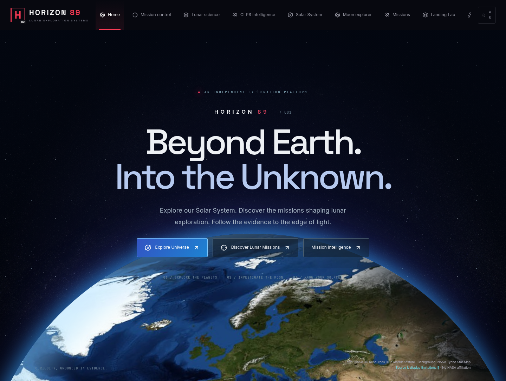

# HORIZON 89

**An independent lunar mission explorer built around one rule: every scientific claim needs a source.**

HORIZON 89 opens on a dedicated cinematic homepage with a locally bundled NASA Tycho star visualization. Explore Universe opens the interactive Solar System with sourced NASA visualization maps; Discover Lunar Missions opens Lunar Mission Control. Select the Moon for a smooth camera approach into the existing lunar mission-control workspace, with CLPS histories, observer-geometry queries and explicit data availability. No NASA or government affiliation is implied.

The research navigation also retains the original Moon explorer (`#moon`), Landing Lab (`#lab`), Knowledge Graph (`#graph`), dedicated Horizon Intelligence workspace (`#copilot`), research-lead catalogue (`#research-missions`), and schematic Solar overview (`#solar-overview`). These hash links can be opened directly, refreshed, and traversed with browser history. The mission-platform Home, Mission control, Lunar science, CLPS intelligence, and Solar System remain available in the primary navigation. The dedicated research assistant uses temporary provider sessions; the mission-platform Copilot uses the optional server key.



## Final presentation and release review

The final pass preserves Phases 1–4.1 and improves API failure/deadline handling, recoverable Solar WebGL loss, keyboard navigation, upfront Copilot configuration, reduced-motion behavior and hidden-tab work scheduling. The local demo needs no key or live provider. Missing science/model data remains explicitly unavailable.

- [Final handoff and actual checks](docs/FINAL_HANDOFF.md)
- [2–3 minute judge demo](docs/DEMO_SCRIPT.md)
- [Project architecture and API boundaries](docs/PROJECT_ARCHITECTURE.md)
- [Scientific sources, imagery and limitations](docs/SCIENTIFIC_SOURCES.md)

Start from this checkout with `npm run dev -- --host 0.0.0.0 --port 5173 --strictPort`. The homepage is the first screen; the frontend uses **5173** and proxies the internal API on **3001**. Explore Universe opens Solar System; Discover Lunar Missions opens Mission Control. With WebGL unavailable, the object directory and source panels remain usable. No release commit, tag, push or deployment is implied by this readiness review.

## Phase 4.1 · homepage and continuous motion

A distinct landing page, local NASA background with gradient/star fallback, delta-time orbit/rotation animation, eased camera travel, restored camera/selection/day/false-color state, reduced-motion support and hidden-tab render suspension. Pausing orbits also pauses illustrative surface rotation. Low-power mode requests motion frames at 30 Hz; actual hardware frame rates are not asserted.

Optional Mercury GLB loading supports `.data/manual-assets/Mercury_1_4878 (1).glb` (and the original unsuffixed name). Raw models stay ignored and outside `public/`; the backend serves only the named local asset via `/api/models/mercury.glb`, with an availability inventory at `/api/models/mercury`. The loader centers geometry, fits its largest dimension to the schematic diameter, preserves authored materials/orientation, and retains a solid fallback. **The user model was not present in this workspace, so its geometry, materials, orientation, performance and provenance remain unverified.** Self-contained GLB 2.0 up to 32 MiB with no required compression extensions is supported. Restart/reopen the Solar scene after adding the file.

See [Phase 4.1 handoff](docs/PHASE41_HANDOFF.md) for actual verification, model limitations and commands. Reproduce the background with `NODE_USE_ENV_PROXY=1 node scripts/science/prepare-space-background.mjs`; source and display hashes are checked before writing. The six prior planetary maps and their provenance remain unchanged.

## Phase 4 · cinematic planetary entry · 0.4.0-rc.1

New opening scene, six pinned NASA visual maps (Venus surface map is explicitly optional false color), Moon highlight/fly-in without a reload, preserved navigation context, back-to-Solar navigation, source manifest and an honest LROC replacement/import path. Missing Sun/Mercury/Uranus imagery and separate cloud maps use labeled untextured materials. The requested LROC TIFF/IMG and live JPL remain network-blocked; no official Moon replacement is claimed.

See [Phase 4 handoff](docs/PHASE4_HANDOFF.md), [planetary map provenance](public/textures/planets/README.md), [LROC import instructions](docs/science/LROC-IMAGERY.md) and [real AI setup/test workflow](docs/AI_SETUP.md).

## Phase 3 release candidate · 0.3.0-rc.1

This release preserves the existing mission/science/atlas workflows and adds a scientific-readiness strip, accessible Moon zoom and target feedback, atlas camera following controls, explicit mission provenance gaps, an in-app local import guide, validation-only DEM inspection, safer output writes and production/API hardening. No remote scientific capability is implied by a configured service. See [Phase 3 handoff](docs/PHASE3_HANDOFF.md) for executed checks and Git delivery.

## Phase 2 scientific intelligence

New: strict PDS3 terrain ingestion and provenance capture, optional elevation/slope color layers, explicit illumination evidence, site comparison with evidence gaps, as-landed coordinate provenance gates, stronger Horizons returned-time validation, and broader Copilot comparison/context support. **No authoritative terrain or new mission-coordinate observations were obtainable here.** These layers remain disabled until reviewed data is imported; synthetic test fixtures are never shipped as science.

See [terrain ingestion and methods](docs/science/INGESTION.md), [candidate dataset inventory](docs/science/candidate-inventory.json), and [Horizons reference verification](docs/science/HORIZONS-VALIDATION.md).

## What works

- Dedicated homepage, Solar System exploration and Moon-to-Mission-Control transition; preserved lunar mission-control screen with bundled photographic Moon image, rotate, zoom, pan, camera reset, target focus, 89°S shortcut, coordinate grid and double-click surface selection.
- Searchable and provider-filtered historical catalog: IM-1/Odysseus, Blue Ghost Mission 1 and Peregrine Mission One. Details, selected payloads, comparison, references and historical event selection.
- Manual, validated geographic targets. The default 89°S, 0°E is an analyst study coordinate, not an asserted mission landing site.
- UTC date selection, day scrubber, play/pause and 1×/60×/600× playback; pause to query a fixed observer instant.
- Server-side JPL Horizons integration, bounded cache, request coalescing, timeouts, input validation, provenance and honest unavailable states.
- Science workspace with imagery/ephemeris availability and explicit missing terrain/PSR datasets.
- Full-screen schematic Solar System: ten selectable objects, focus, orbital guides, animation, Earth–Moon relationship and Saturn’s rings.
- Real server-side AI Copilot integration with context and bounded conversation history; useful missing-key/error states. No fake assistant responses.
- Responsive navigation, keyboard command search (Ctrl/Cmd K), graphics quality, WebGL/texture fallbacks and reload recovery.

**Partial / unavailable:** real Horizons results cannot be verified in this cloud instance because outbound access to JPL is denied. AI generation needs a server API key and provider access. Mission landing coordinates are withheld because no verified coordinate dataset was present. Elevation/slope processing is implemented for the documented input subset but has no reviewed real data loaded. Ice, permanent-shadow and radio-link analysis remain unavailable. The catalog is a deliberately small historical snapshot, not a live comprehensive CLPS feed. See [HANDOFF.md](HANDOFF.md).

## Requirements & installation

Node.js 24 (validated: 24.22.1), npm (validated: 11.9.0), and a WebGL2-capable browser. Use the existing checkout; no extra worktree or duplicate app is required.

```sh
cd /workspace/horizon-89 # or your local checkout
npm ci
npm run dev
```

`npm run dev` compiles the server, watches server TypeScript, starts the API on port 3001 and starts Vite on port 5173. It needs no key for catalog, imagery, manual targets, timeline, science and atlas exploration. Ctrl-C stops its child processes. For a cloud-bound frontend:

```sh
npm run dev -- --host 0.0.0.0 --port 5173 --strictPort
```

Vite proxies `/api` to `127.0.0.1:3001`. Stop a separately running API before invoking the combined development command. `npm run dev:web` starts only Vite; `npm run build:server && npm run dev:api` watches the compiled API, but use the combined command for automatic server-source rebuilding.

## GitHub Codespaces preview

1. Open a Codespace on `feat/horizon89-mission-platform`.
2. In its terminal, run `nvm install && nvm use` if Node 24 is not already selected, then:

   ```sh
   npm ci
   npm run dev -- --host 0.0.0.0 --port 5173 --strictPort
   ```

3. Open the **Ports** tab, forward port **5173** if necessary and choose **Open in Browser**. Keep port visibility **Private**. Port 3001 is the internal backend; do not expose it separately. The development proxy preserves the forwarded browser host for same-origin POSTs.
4. Optional server keys belong in ignored `.env` or secure environment settings. Restart after changing them. Catalog, local imagery, manual targets, timeline, comparison and atlas need no key. DEM layers require a reviewed import; ephemerides and AI additionally require reachable providers.

The exact dev command and a simulated forwarded-HTTPS-host request were tested locally. An actual hosted Codespace/public deployment was not provisioned in this task. No public deployment is claimed.

## Server configuration

Optional: copy `.env.example` to `.env` and supply values locally or through your deployment’s secret settings. `.env` is ignored by Git. Never prefix secrets with `VITE_`.

| Variable             | Purpose                                              | Default                                                  |
| -------------------- | ---------------------------------------------------- | -------------------------------------------------------- |
| `H89_AI_API_KEY`     | Server-only OpenAI API key; no generation without it | Unset                                                    |
| `H89_AI_MODEL`       | Model available to your account                      | `gpt-4.1-mini`                                           |
| `PORT`               | Backend / production HTTP port                       | `3001`                                                   |
| `HOST`               | Backend bind address                                 | `127.0.0.1` in development; `0.0.0.0` with `npm start`   |
| `NODE_USE_ENV_PROXY` | Honor inherited HTTP(S) proxy settings in Node 24    | Enabled by provided scripts                              |
| `CHROMIUM_PATH`      | Optional executable override for browser tests       | System Chromium if present; otherwise Playwright browser |

Network destinations: `registry.npmjs.org` for installation, `ssd.jpl.nasa.gov` for observer geometry and `api.openai.com` for AI. Public source links open official NASA pages in the user’s browser. No runtime image download is needed. Preserve platform CA trust and TLS verification. This task did not change or publish environment settings.

## APIs & scientific interpretation

- `GET /api/science`: available validated bounded DEM artifact, or explicit unavailable state; no terrain values are fabricated.
- `GET /api/health`: process readiness and whether Copilot is configured; it does **not** prove upstream readiness.
- `GET /api/horizons?lat=-89&lon=0&time=2025-03-02T06:00:00.000Z`: Sun (`10`) and Earth (`399`) from a lunar (`301`) geodetic surface observer, height 0 km. Input longitude is east-positive, degrees. UTC timestamps must end in `Z`; supported years 1962–2100. Returns calculated apparent airless azimuth/elevation, requested/fetched times, source, frame and cache status. Azimuth is north through east. Integration contract is tested with fixtures; live numerical accuracy remains to be cross-checked against JPL on an unrestricted network.
- `POST /api/copilot`: JSON `{question, missionId, compareMissionIds, site, timeUTC, solarBody, history}`. Server supplies its catalog, dataset inventory, selected object and any matching cached sourced geometry. Client history is bounded and restricted to user/assistant roles. Answers are AI-generated, not authoritative scientific results.

Horizons requests have a 12-second upstream timeout, 100-entry / 5-minute cache and concurrent-request deduplication. The AI timeout is 20 seconds. JSON bodies are limited to 16 KB; questions to 1,500 characters. API requests have a basic in-memory limit of 60 per minute per connection IP. Errors remain JSON; credentials and upstream response bodies are not echoed.

**Interpretation:** source-based ephemerides are calculated values, not measured live telemetry. An Earth elevation above zero is only a flat-horizon geometric condition. It does not establish terrain line of sight, radio coverage or link availability. Lighting in the viewer is studio lighting; it does not follow simulation time. No image brightness is converted into elevation or bump data.

## Sources & data

`src/data/catalog.ts` stores typed historical mission records, source URLs, snapshot dates, events, dataset availability and approximate orbital-period reference values. The NASA mission facts are a curated historical transcription; source pages could not be re-fetched through this instance’s network policy. Exact landing coordinates are deliberately null rather than guessed.

The 1024×512 Moon image is bundled from the Three.js example assets (238,093 bytes). Its upstream acquisition/registration metadata is not supplied; it is qualitative imagery, not an asserted LRO mosaic or a precision map. See [texture provenance and license](public/textures/README.md). Source links in the interface identify NASA CLPS, mission references, Horizons, LOLA and planetary references.

The Solar System uses illustrative circular coplanar orbits, arbitrary initial phases, compressed distances and exaggerated body sizes. Approximate orbital periods drive schematic motion; no real-time ephemerides or true scale are claimed. NASA display maps are used where available. Missing objects use labeled plain materials; false-color Venus is opt-in. No invented photographic map or procedural cloud pattern is substituted.

## Architecture

```text
src/App.tsx                 navigation, selected mission/site, UTC simulation state
src/components/MoonViewer   lazy R3F globe, image loading, controls, grid, recovery
src/components/Telemetry    debounced/cancelled queries, provenance, freshness checks
src/components/Copilot      contextual chat, errors, submission and copying
src/components/Home        cinematic homepage with local NASA background
src/components/MercuryModel optional local GLB loader with material/geometry disposal
src/components/SolarExplorer lazy schematic atlas
src/components/SceneBoundary render fallback
src/data/catalog.ts         typed catalog / source and availability manifest
src/lib/science.ts          geographic transforms and UTC/playback helpers
src/services/horizons.ts    typed client service boundary
server/horizons.ts          query validation, JPL request construction and parser
server/index.ts             native Node HTTP API, cache, AI and production static files
scripts/dev.mjs             dependency-free development process orchestration
```

React 19, TypeScript 6, Vite 8, Three.js / React Three Fiber / Drei, Lucide, Oxlint; Node’s native HTTP server and fetch. Playwright is the only added package, as a development dependency. The 3D stack is lazy-loaded; default DPR is capped at 1.25, the globe uses modest geometry and on-demand rendering. Decorative stars are schematic graphics; no synthetic scientific surface or texture-derived displacement is used.

## Checks

```sh
npm run lint          # no warnings/errors on the completed implementation
npm run build         # frontend type check + Vite build + strict backend TypeScript build
npm test              # builds frontend and backend, then Node unit/API tests for both APIs
npm run test:browser  # production build required; starts/reuses API on 3001
npm run check:secrets # credential-pattern and raw-artifact checks; no values printed
```

For browser tests on a machine without system Chromium, run `npx playwright install chromium` once, or set `CHROMIUM_PATH` to your installed Chrome/Chromium executable. The cloud instance already provides `/usr/bin/chromium`.

Current results and limitations are recorded in [FINAL_HANDOFF.md](docs/FINAL_HANDOFF.md); prior phase reports remain historical evidence. Fixture-based remote-provider contracts are explicitly separate from live service verification. Screenshots are real application captures, not mockups: [desktop](docs/landing.png), [mobile](docs/mobile.png), [atlas](docs/solar-system.png).

## Production deployment

```sh
npm ci
npm run build
HOST=0.0.0.0 PORT=3001 npm start
```

The Node server serves `dist/` and `/api` from one origin. Deploy `dist/`, `dist-server/` (including its copied research API and evidence registry), `package.json` and the Node runtime together (or retain the checkout). The compiled backend needs only Node built-ins and compiled catalog files. For internet-facing operation, place it behind HTTPS and configure trusted access, quotas and durable rate limits appropriate to your deployment. The bundled limiters and research sessions are process-local; this application is not flight-qualified mission operations software. A static-only host can serve the offline frontend, but requires a same-origin API reverse proxy for Horizons and both Copilot workflows. No deployment or publication was performed here.

### Render web service settings

Create a **Node** web service from this repository after reviewing the audit branch. Use Node **24** (the repository's `.nvmrc`), npm with `package-lock.json`, build command `npm ci && npm run build`, start command `npm start`, and health check path `/api/health`. Render supplies `PORT`; `npm start` binds to `0.0.0.0` in production when `HOST` is unset. Do not set `HOST=127.0.0.1` on Render. Set `H89_AI_API_KEY` as a secret only if Copilot should be enabled; `H89_AI_MODEL` optionally selects the model (default `gpt-4.1-mini`). Neither is needed for the catalog, imagery or local science views. `NODE_ENV=production` is set by the start script. Keep secrets out of `VITE_*` variables and source files.

The health endpoint confirms the process is serving requests; it does not probe JPL or an AI provider. Horizons needs outbound HTTPS to `ssd.jpl.nasa.gov`. The mission-platform Copilot needs `api.openai.com` and `H89_AI_API_KEY`; the dedicated research assistant accepts a temporary OpenAI or Gemini key through `/api/session/config` and needs outbound HTTPS to the selected provider. Its evidence registry currently contains pending leads only, so it explicitly declines evidence-backed synthesis until verified records are imported. The current in-memory rate limiters see the proxy address unless a trusted proxy strategy is added; configure edge protection before public use if abuse resistance is required. No verified terrain import or live provider result is included in the build.

## Manual scientific import

Upload the supported detached PDS3 `.lbl` / `.img` plus reviewed provenance JSON into ignored `.data/lola/` through Codespaces Explorer. Record the actual source `retrievedAt` in UTC, not the conversion time. Validate without producing output:

```sh
npm run science:inspect -- .data/lola/PRODUCT.lbl .data/lola/PRODUCT.img .data/lola/provenance.json
```

Then follow [the complete import instructions](docs/science/INGESTION.md) and the operator guide in Lunar science. Unsupported inputs/checksum failures are rejected. Successful synthetic-fixture tests do not establish that a real LOLA product has been processed or independently validated.

## Optional imagery and AI workflows

```sh
npm run imagery:prepare        # Verify/reproduce pinned NASA display maps
npm run science:import-moon -- .data/lroc/REGISTERED_DISPLAY.tif .data/lroc/review.json
npm run test:ai:live           # Real response only with a configured key; otherwise explicit skip
```

The WAC importer supports a deliberately strict registered 8-bit GeoTIFF subset. Read the LROC guide first; no real LROC file was available for validation here.

## Demo & next steps

See the [2–3 minute demo script](docs/DEMO_SCRIPT.md), [scientific sources](docs/SCIENTIFIC_SOURCES.md), [architecture](docs/PROJECT_ARCHITECTURE.md), and [final handoff](docs/FINAL_HANDOFF.md). Priorities are a permitted, independently cross-checked live JPL query, a configured AI provider, verified mission coordinate ingestion and georeferenced terrain datasets.
