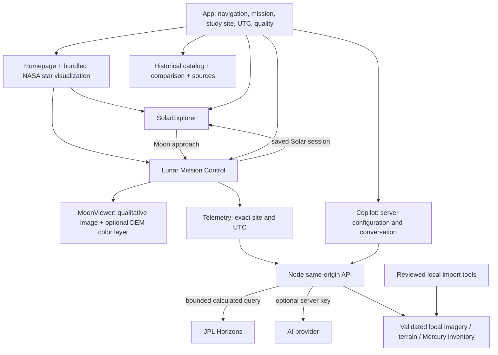

# HORIZON 89 architecture

The existing React 19 / TypeScript 6 / Vite 8 app uses Three.js, React Three Fiber and Drei for lazy-loaded 3D scenes. Node 24’s native HTTP server implements the same-origin APIs. No new dependency was added in the final pass.



## Frontend ownership

| File | Responsibility |
| --- | --- |
| `src/App.tsx` | Home/control/science/missions/Solar navigation; catalog selection, analyst coordinates, UTC, shared graphics quality, Solar session snapshots and command search |
| `components/Home.tsx` | Distinct default landing page, both CTAs, local NASA background/credit and image-failure fallback |
| `components/SolarExplorer.tsx` | Compressed circular orbit scene, selectable objects, local display maps, schematic motion, camera flights and recoverable WebGL state |
| `components/MercuryModel.tsx` | Optional self-contained GLB parse, center/scale normalization, authored materials, failure fallback and GPU-resource disposal |
| `components/MoonViewer.tsx` | Lunar map sphere, coordinate picking, camera/grid/marker controls, optional DEM color overlay and context-loss reload |
| `components/Telemetry.tsx` | Debounce/cancel requests; reject stale or mismatched site/UTC/body geometry; distinguish calculated, cached and unavailable states |
| `components/Copilot.tsx` | Upfront server configuration, bounded history/context, real request/error flow, clipboard action and keyboard focus/close behavior |
| `components/Readiness.tsx`, `TerrainPanel.tsx`, `SiteComparison.tsx`, `LunarImagery.tsx` | Inventory/provenance, evidence gaps, optional data layers and explicit source limits |
| `components/SceneBoundary.tsx` | Contain 3D failures and notify the owner so rendering/navigation can recover |
| `lib/useScenePreferences.ts` | Observe browser visibility and reduced-motion preference with cleaned-up listeners |
| `services/horizons.ts` | Shared JSON transport: caller cancellation plus a retained 25-second deadline; reject non-JSON/invalid JSON responses |
| `data/catalog.ts`, `data/planetImagery.ts` | Typed historical records, reviewed-coordinate gating, approximate reference orbital periods and imagery interpretation |
| `science/terrain.ts`, `science/geotiff.ts` | Constrained format/registration validation and scientific transforms |

Navigation is in memory, without unnecessary reloads. Solar selected body, schematic day, camera/target, tracking and false-color choice survive workspace navigation. Lunar study/mission/time/quality state stays in App. Reload resets the session except graphics quality, stored opportunistically in localStorage. Source imports and provider configuration are not inferred from UI state.

## Server routes

| Route | Contract |
| --- | --- |
| `GET /api/health` | Process readiness/version and whether server AI configuration exists; not proof of remote availability |
| `GET /api/imagery` | Hash-validated optional LROC display manifest or explicit legacy-image fallback |
| `GET /api/science` | Bounded, validated DEM artifact or unavailable inventory |
| `GET /api/models/mercury` | Availability of the recognized optional local GLB; absence returns normal inventory, not invented geometry |
| `GET /api/models/mercury.glb` | Serve only a recognized self-contained local model; raw directory remains outside the static root |
| `GET /api/horizons` | Validate coordinates and 1962–2100 UTC; Sun/Earth lunar-surface airless observer geometry; exact returned-time checks |
| `POST /api/copilot` | Validate bounded question/history/context; call provider only with a server key; no fabricated answer |
| Other non-API paths | Built `dist/` files or app HTML; hidden paths, malformed paths and escaping symlinks rejected |

Horizons has a 12-second upstream deadline, 100-entry/5-minute cache and request coalescing. Cached values retain the original site/time/source and are labeled cached. AI has a 20-second upstream deadline, 16 KB request-body cap and bounded messages. The API uses a basic in-process 60 requests/minute/IP limiter. Origin checks preserve same-origin requests through the documented Vite/Codespaces host-preserving proxy. Provider error bodies and credentials are not echoed.

## Data and security boundaries

- Private values stay in ignored `.env` or server environment settings, never `VITE_*` or browser bundles. No key is supplied, requested or invented in this release pass.
- Raw products and Mercury models remain in ignored `.data/`, not Git or `public/`.
- PDS3 ingest uses reviewed provenance, source-size/hash validation, explicit projection/units/no-data checks, bounded row caching and staged outputs. Runtime serves only bounded artifacts. It is not a general browser file-upload service.
- Optional LROC import checks actual TIFF/GeoTIFF registration plus source/display hashes. Unsupported data fails closed; no guessed geospatial tags.
- Mercury accepts only the named GLB 2.0 files, up to 32 MiB, with no escaping symlinks/external resources or unconfigured required decoder extensions.
- Production static files are realpath-checked under `dist/`; fingerprinted JS/CSS use immutable caching. HTML/inventories remain refreshable.

## Rendering and test boundaries

Scenes render on demand. Solar requests active motion frames at about 30 Hz in Low power and up to about 60 Hz otherwise; ref mutations drive per-frame transforms while React snapshots are throttled. Hidden scenes stop rendering; hidden/non-control UTC playback stops scheduling work. Reduced motion disables orbital/spin playback and uses immediate selection travel, including lunar damping preferences. Texture/geometric resources and event/timer listeners are cleaned up. These are implementation budgets, not measured hardware FPS or battery claims.

The shared lazy Three/R3F chunk remains about 926 KB minified; the build warning is retained. No bloom/post-processing package was added. Tests cover Node unit/API/science contracts and Chromium viewport/GPU/fallback workflows. Synthetic DEM/TIFF/GLB fixtures exist only in tests. They do not establish real terrain registration, actual-user-model quality or live JPL numerical accuracy. Physical touch devices, Safari and public deployment remain outside this validation.

## Running

```sh
npm run dev -- --host 0.0.0.0 --port 5173 --strictPort
```

`scripts/dev.mjs` compiles/watches the backend, starts it on 3001 and launches Vite 5173, proxying `/api` to the backend. Stop a separately running API before starting it. For production validation: `npm run build && npm start`. A static-only host does not provide the APIs. No deployment was performed.
