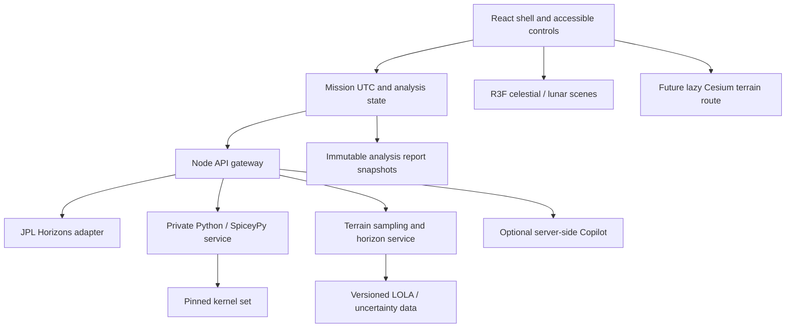

# Horizon 89: repository truth and implementation design

Scope: Phase One only. Later phases below are proposals, not implementations.
Audit/research date: 2026-10-26. The second supplied specification supersedes the
first document's instruction to proceed into a Solar System UI.

## Audited baseline

Repository: `indscope/horizon-89`, origin `github.com`, branch `work`, initial HEAD
`f7a10e70303964f42b9b0fd90ee98927ce4fafec`, identical to origin/main. Three commits:
initial README, configuration upload, frontend upload. Remote refs contain only
main. Read-only origin access works with the platform HTTPS authentication.
`git log --all`, branches, reflog, full object check, all three commit trees, and
workspace searches found no older backend/test implementation. No dangling Git
objects were reported. `/workspace/.git` is not a usable project repository.
No user changes existed before this task. Nothing was reset, cleaned, pushed,
or discarded. An inaccessible prior cloud workspace cannot be searched here;
absence applies to this accessible workspace and repository, not all history.

The frontend entry is `src/main.tsx`, importing `src/App.tsx` and theme CSS.
`App.tsx` contains the Moon scene, site controls, environment gauges, demo timeline,
and UI-only Copilot dock. The client `src/services/horizons.ts` calls `/api/horizons`.
Vite proxies `/api` to 127.0.0.1:3001. There is no server, health/readiness endpoint,
upstream parser, cache, AI provider integration, backend tests, Solar System
navigator, Cesium, SPICE runtime, or terrain pipeline. The earlier 30 tests are
historical claims and were not recovered. Current checks are newly added and
must not be described as those recovered tests.

Initial `npm run build` passed (TypeScript + Vite); lint exited 0 with five
warnings. Initial browser rendering crashed on missing `/textures/moon-lro.png`.
Neither the TIFF nor generated texture exists in any project commit or searched
workspace. No replacement was downloaded. The globe's latitude/longitude mapping
and real imagery orientation are not scientifically verified. Existing hard-coded
lighting is illustrative; a label now states that explicitly. The former image
bump map was scientifically inappropriate and is removed.

## Phase One changes and limits

- Central shared contracts distinguish physical vectors, display state, provenance,
  measurements, UTC, errors, and source status. Existing wire names remain available.
- The legacy adapter preserves precision, signed longitude and timestamps. Missing
  retrieval time, altitude, frame and correction metadata stay null. It does not
  infer LIVE or a verified frame from a provider name.
- Client validation, 15 s abort, safe failures, schema/site/epoch checks prevent
  malformed responses being presented as measurements. There is no new astronomy.
- Missing imagery renders a neutral reference sphere and an UNAVAILABLE label;
  texture lifecycle cleanup is explicit. A source-dependent conversion script exists.
- Small-screen CSS no longer hides site controls. This is a narrow accessibility
  correction, not a new interface design.
- Kernel bootstrap and deterministic client/integrity/browser tests are added.

Remaining baseline gaps include lost last-successful analysis on a failed query,
site/time changing before successful analysis, and an existing timeline limited to
a demo date. Do not mistake them for the richer historical telemetry implementation.
Recover that implementation before redesigning its state or API contracts.

## Target modular architecture

Proposed source boundaries: `shared/` wire/science contracts; `src/science/` pure
adapters; `src/scenes/` view-specific renderers; `src/state/` mission/navigation
state; `server/` restored gateway; `science/` bootstrap then separately authorised
service; `terrain/` later offline processing. Keep the current mission dashboard
and client wire contract behind adapters until tested migration is available.

### State and camera design (future)

One central UTC string with milliseconds controls all physical calculations.
Separate draft site/time, pending request, last successful immutable analysis,
and current navigation state. A result is keyed by site + UTC + method +
frame/model version. Cancellation/request IDs prevent late responses replacing
newer selections. On failure retain the successful snapshot with its original
site/time visibly identified; mark the new request UNAVAILABLE.

Navigation is a finite-state flow: system → focused body → Earth–Moon → lunar
operations → terrain. Keep selected body, camera target, interrupted transition,
and return camera in navigation state, never physical ephemeris data. Camera
motion interpolates display coordinates; user input cancels it. Reduced motion
uses immediate focus. Essential actions have DOM/keyboard controls. Preserve UTC
and selected site on return. Suspend/unmount the renderer being left.

### Ephemeris decision (future)

| Option | Use | Limit |
|---|---|---|
| Horizons observer tables | Preserve lunar apparent Sun/Earth AZ/EL; independent external oracle | Network latency, upstream failures, not per-frame animation |
| Pinned SPICE via isolated Python/SpiceyPy | Reproducible vectors, orientation, frame transforms | Native runtime and kernel coverage must be validated |
| Browser approximations | Educational, explicitly lower-accuracy contexts only | Cannot replace requested authoritative physical state |

Recommendation: Node gateway + private science process. Compare supported
SpiceyPy versions before pinning; no package version from a pasted handoff is
assumed current without checking. Keep physical states in kilometres, km/s,
explicit J2000 frame/centre, exact epoch, `abcorr=NONE` for simultaneous system
geometry. Apparent observer states are separate. Use MOON_ME for map/site work,
MOON_PA when required, and ITRF93 only inside Earth-PCK coverage. Inspect the
actual DE440s target set: outer-planet barycentres are not their body centres.

Batch time samples and interpolate only with documented error checks/provenance;
never call APIs per rendered frame. Render size/distance compression is a pure
transform with visible scale disclosure. It must not mutate physical vectors.
Compare at least three epochs to Horizons vectors with matched frame, centre,
time scale and correction before approving a scientific tolerance.

## Official-source research

These facts were checked by downloading official documentation over verified
HTTPS. Initial proxy 403s cleared after the domain draft update. This is source
research, not verification of an implemented science engine.

| Source | Provides / convention | Coverage, precision and integration |
|---|---|---|
| [Horizons manual](https://ssd.jpl.nasa.gov/horizons/manual.html) | Quantity 4 topocentric apparent AZ/EL in degrees; azimuth north→east; AIRLESS omits atmospheric refraction | Apparent corrections include light time, deflection and aberration. Precision is not accuracy; preserve metadata. API returns JSON-wrapped text; existing backend parser absent. Network-only browser requests should go through fixed-host gateway. |
| [LROC product](https://data.lroc.im-ldi.com/lroc/view_rdr_product/WAC_GLOBAL_E000N0000_008P) | Morphology imagery; simple cylindrical, 0°N/0°E centre; ±180° longitude, ±90° latitude | 8 px/degree; page declares 2880×1440, 3790.42 m/px and TIFF ~3.96 MB. Colour texture only. Static mapped mosaic, not live illumination or a height model. Missing locally. Derive WebP with provenance; check landmark orientation before release. |
| [NAIF lunar FK](https://naif.jpl.nasa.gov/pub/naif/generic_kernels/fk/satellites/moon_de440_250416.tf) | MOON_ME/MOON_PA aliases, fixed ME-to-PA transformation | Explicitly compatible with DE440 lunar binary PCK. ME is closely aligned with DE421, not assumed identical. Small support file; server-side load with kernel set. |
| [NAIF lunar PCK comment](https://naif.jpl.nasa.gov/pub/naif/generic_kernels/pck/moon_pa_de440_200625.cmt) | Lunar orientation from DE440 relative to ICRF | Official documented ET interval 1549-12-31–2650-01-25. Runtime transform/segment tests still needed. ~12.9 MB; not browser bundle. |
| [NAIF Earth comment](https://naif.jpl.nasa.gov/pub/naif/generic_kernels/pck/earth_000101_270121_261025.cmt) | ITRF93 Earth orientation, reconstructed and predicted | Dated 2026-10-25; TDB endpoints in manifest; UTC last datum 2026-10-25. ~5.2 MB. Refresh via reviewed pins and fail outside coverage. |
| [NASA PGDA product 78](https://pgda.gsfc.nasa.gov/products/78) | LOLA-derived 5 m/pixel DEM, slopes, point counts and uncertainties; south-polar stereographic X/Y metres, MOON_ME DE421 | Page reports ~90% interpolated pixels for described products, median RMS height errors ~0.30–0.50 m, slope ~1.5–2.5°. These are product-specific, not guarantees for every lunar point. Server/offline raster processing; stream tiles, never raw full DEM in browser. |
| [Cesium Ellipsoid](https://cesium.com/learn/cesiumjs/ref-doc/Ellipsoid.html) | Ellipsoid.MOON is a lunar-radius sphere | An ellipsoid is not terrain or a frame transformation. Imagery/terrain providers, projections and lunar tile georeferencing need separate validation. Lazy load only in later phase. |

DE440s embedded comments give 1849-12-26–2150-01-22 and its included targets.
These documented intervals are recorded in the pinned manifest; no actual SPICE
coverage query was run in Phase One.

Licensing/attribution gate: preserve NASA/JPL/NAIF and LROC product authorship,
source URLs, release versions, hashes and original labels. Official hosting alone
is not a blanket licence determination. Before redistribution, review each product's
terms/credits, any third-party data, and any Cesium ion content/access contract.
CesiumJS code availability does not imply hosted lunar tiles are free or licensed
for this application. No paid dataset or provider was introduced. NASA CLPS mission
catalogue ingestion and USGS/PDS product-by-product surveys remain future source
work; no unsupported mission coordinates were added.

## Terrain pathway (proposal)

1. Select a bounded official LOLA ROI and retain source GeoTIFF metadata, nodata,
   vertical datum/reference radius, projection, ME frame version, uncertainty and
   count maps. Confirm planetocentric/geodetic latitude definitions before use.
2. Preprocess outside the browser (GDAL-style tools after authorisation). Keep
   scientific samples in the product's original units and frame. Make tiled/LOD
   display assets separately; require the same check points across both engines.
3. Build elevation queries with explicit interpolation/nodata rules. Validate
   slope calculations on analytic surfaces and against supplied slope products.
4. Build horizon profiles by azimuth using georeferenced DEM samples, observer
   height and lunar curvature. Test flat surfaces, ridges, craters, polar/dateline
   coordinates, nodata and uncertainty. Do not infer heights from the LROC image.
5. Compare apparent Sun/Earth direction with local horizon masks; separately
   model finite solar disc, eclipses and time windows. Terrain visibility alone
   still is not communications availability or solar-power output.
6. Cesium route uses validated lunar ellipsoid/tile transforms; do not assume a
   terrestrial Web Mercator terrain stack works on the Moon. Budget ROI tiling,
   storage, hosting/egress and provider terms before choosing a provider.

## Performance and security design

Target 8 GB integrated-GPU laptops. Only one heavy scene active. Lazy-load the
future Cesium renderer and dispose inactive geometry/materials/textures. Initial
JS budget ≤450 KB gzip; current measured JS is ~324 KB gzip with a >500 KB raw
chunk warning. This is a transfer measurement, not an FPS/memory certification.

Quality modes may cap DPR (~1 / 1.3 / 1.7), stars and geometry. Science precision
must remain identical. Texture planning budgets (RGBA + mipmaps): ~2.7 MiB at
1024×512, ~10.7 MiB at 2048×1024, ~21.1 MiB at 2880×1440. WebP reduces transfer,
not decoded GPU memory. Consider KTX2 later after orientation/content validation.
No synchronous giant raster work in the gateway; bounded science caches/workers.

Server recovery must preserve fixed JPL hosts, validate all public inputs, use
abort timeouts, bounded successful-only cache, request IDs, rate limits, safe
errors, secure headers/CSP, liveness/readiness and graceful shutdown. Keep all AI
keys server-side, never VITE_*. Current frontend needs no credentials. Secret
pattern scanning is heuristic; `.env*` ignored except the placeholder example.
CI uses read-only permissions, pinned action SHAs and no credentials caches.

## Independently testable roadmap

| Gate | Deliverable | Acceptance |
|---|---|---|
| Phase One (current) | Repository truth, shared contracts, honest fallback, asset scripts, pinned kernel bootstrap, CI | Local checks recorded; missing backend/source explicitly unresolved. Full science baseline NOT accepted yet. |
| Phase One recovery follow-up | Recover original server/tests or separately authorise bounded restoration | Health/readiness, deterministic captured JPL fixtures, cache/error/UTC tests, last-successful-state retention; real-provider claims require successful tests. Restore genuine TIFF and verify UV landmarks. |
| Phase Two (not started) | Private SPICE celestial-state engine | Kernel load/coverage and missing-file failures, frame/centre/epoch/aberration cross-checks at multiple epochs, explicit target availability and provenance. |
| Celestial UI | System map, body focus, Earth–Moon return paths | UTC continuity, keyboard/touch/reduced-motion navigation, scale disclosures, no network-per-frame, no invented orbits. |
| Scientific lighting | Sun vector transformed into lunar display frame | Known orientation/terminator tests; distinguish illustrative fill from physical illumination. |
| Terrain route | Lazy Cesium plus georeferenced lunar ROI | No simultaneous heavy renderers; cross-engine check points and coordinate tests. |
| Terrain/visibility | DEM sampling, uncertainty, horizon profiles, windows | Analytic surfaces + official ROI regressions; no-data and boundary cases; disc/eclipse limitations. |
| Mission analytics | Sourced CLPS sites, comparison, reports, then Copilot | Immutable report provenance, deterministic computations, AI explains rather than computes science. |

No Phase Two, navigator, terrain service, Cesium or Copilot expansion was started.
